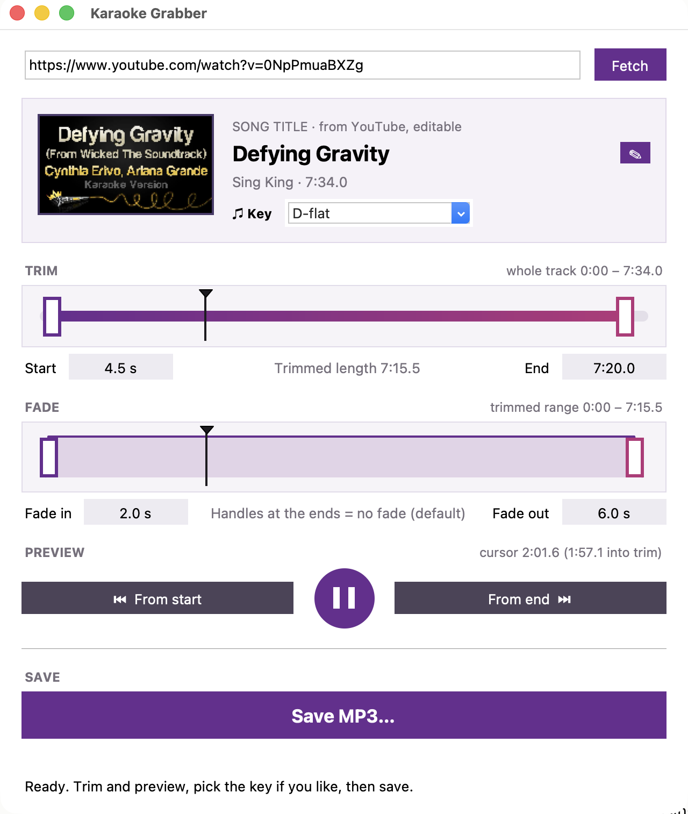
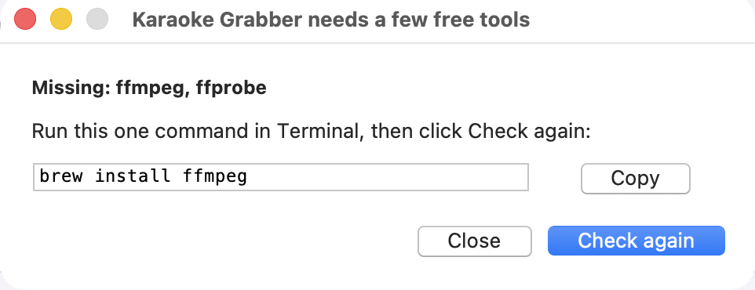
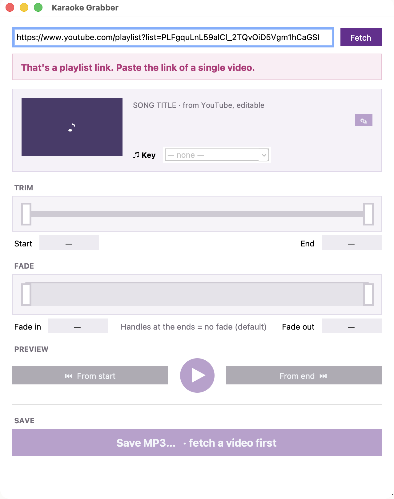
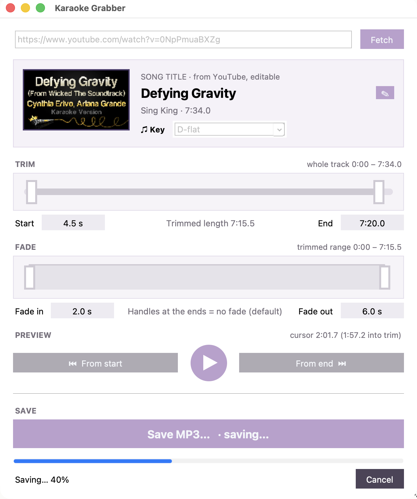

# Karaoke Grabber — User's Guide

Karaoke Grabber turns a karaoke (backing) track on YouTube into an MP3
you can rehearse and perform with: trimmed to start and end where you
want, with optional fades, and named the way you name your tracks.

## Before the first time

Karaoke Grabber uses three free tools that do the downloading and audio
work. If any are missing when it opens, it shows a small window saying
which, with the one command that installs them:

1. Click **Copy**.
2. Open **Terminal** (in Applications ▸ Utilities), paste with ⌘V and
   press Return. It takes a minute or two.
3. Back in Karaoke Grabber, click **Check again**.

If it says Homebrew itself is missing, click **Open brew.sh** and follow
the one-line install there first.

The first time you open the app, macOS may say it can't check it.
Right-click the app, choose **Open**, then **Open** again. You only do
this once.

## Getting a track

1. On YouTube, find the karaoke video and copy its link from the address
   bar (it looks like `https://www.youtube.com/watch?v=…` or
   `https://youtu.be/…`).
2. Paste it into the box at the top of Karaoke Grabber and press Return,
   or click **Fetch**.
3. The progress bar walks through the steps: looking up the video, getting
   the thumbnail, downloading the audio. A song takes a few seconds. You
   can **Cancel** at any time.
4. Check the card: thumbnail, title, channel and length. If it's the wrong
   video, just paste another link.

Only a link to a single YouTube video works. If the box holds anything
else, like extra words, a playlist link, or a link from another site,
Karaoke Grabber says so right under the box:

## Trimming by ear

- The **Trim** slider covers the whole track. Drag the left handle past
  the channel intro or count-in you don't want, and the right handle in
  from the end to cut the outro. Start, End and the trimmed length show
  underneath.
- After every change, Karaoke Grabber prepares a new preview in the
  background. It takes about half a second for a song, while the play
  buttons are grey.
- Listen:
  - **From start** plays from the trim start, so you hear exactly where
    your track will begin.
  - The **round button** plays from the black cursor, or pauses. **Space**
    does the same.
  - **From end** plays the last 10 seconds, so you hear exactly where it
    ends.
- Click anywhere on either slider's track to move the cursor there, even
  while it's playing.

## Fades

The **Fade** slider covers just the trimmed part. Drag its left handle in
for a fade-in and its right handle in for a fade-out; the lengths show
underneath. Handles at the ends mean no fade, which is the default. Listen
with **From start** and **From end**.

## Title and key

- The title comes from YouTube. Click the purple **✎** to tidy it, for
  example to remove "(Karaoke Version)". Return saves, Esc cancels.
- Pick the **Key** if you want it in the file name. It's optional; leave it
  at "— none —" and the key is simply left out.

## Saving

Click **Save MP3…** or press ⌘S. The Mac's Save window opens with the name
filled in:

- `Defying Gravity - AUDIO - D-flat.mp3` with a key, or
- `Defying Gravity - AUDIO.mp3` without one.

It opens in the folder you saved to last time. Saving takes a few
seconds; **Cancel** stops it and nothing is written.

When it's done, click **Reveal in Finder** to see the file. The MP3 is
the trimmed, faded track at high quality, ready for Music, a playlist or
a gig.

## Shortcuts

| Key | Does |
|-----|------|
| Return (in the link box) | Fetch |
| Space | Play or pause the preview |
| ⌘S | Save MP3… |
| ⌘Q | Quit (stops anything still running) |

## When something goes wrong

- **"yt-dlp may be out of date"**: YouTube changed something. Open
  Terminal, run `brew upgrade yt-dlp`, and try again.
- **"Couldn't reach YouTube" or "the internet connection dropped"**: check
  your connection, then click Fetch again.
- **"The disk is full" or "can't be written to"**: save somewhere else.
- Every error has a **Details** link with the technical output, in case
  you want to look closer or send it to someone.
