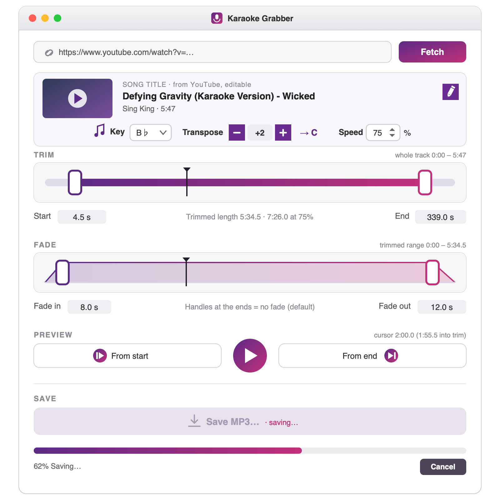

# Karaoke Grabber — Product Spec

**Status:** v1.2 shipped 2026-10-11 (adds Speed, F18). v1.1 shipped 2026-10-11 (Transpose, F17); v1.0 shipped 2026-10-04.
**Date:** 2026-10-11
**Owner:** markstahl
**Related:** [architecture.md](architecture.md) · [build_plan.md](build_plan.md) · [dev_environment.md](dev_environment.md) · [roadmap.md](roadmap.md)

---

## 1. Summary

**Karaoke Grabber** is a small, double-clickable macOS app that turns a
YouTube karaoke (backing) track into a trimmed, correctly named MP3 in the
key I sing it in, at the speed I want, ready to rehearse or perform with.

## 2. Problem

As a working singer, I often find the backing track I need on YouTube.
Getting it into a usable form today means several steps: run a
command-line downloader, convert the audio, trim off the channel intro and
outro in an audio editor, shift it into my key if it isn't already, slow
it down to learn it, then rename the file to my convention. That's fiddly, slow, and easy to get
wrong in the rush before a rehearsal.

## 3. User & goals

**User:** me, a singer on a single Apple Silicon Mac. I'm comfortable
with simple apps and occasionally with the terminal, but I don't want to
use the terminal for this.

**Goals:**

- Go from a YouTube URL to a trimmed, named MP3 in **under a minute** for
  a typical 4-minute track.
- **No terminal needed** for the everyday workflow.
- **Sing in my key:** shift a track up or down by semitones without
  changing its tempo, and hear it before saving.
- **Learn it slowly:** play and save a track slower (down to half speed)
  or a little faster, without changing its pitch.
- Every saved file follows my naming convention:
  **`<Song Title> - AUDIO - <key>.mp3`**, where the key is the one I'll
  hear (after any transposing), or **`<Song Title> - AUDIO.mp3`** when I
  don't pick a key. A speed other than 100% is added, e.g.
  `<Song Title> - AUDIO - C (75%).mp3`.

**Non-goals:**

- A general-purpose video downloader, including video, format pickers or
  subtitles.
- Library management, playlists or batch downloads.
- Distributing the app to other people.

## 4. User workflow

1. **Paste** a YouTube link and click **Fetch**.
2. **Confirm** it's the right track from the title, channel, duration and
   thumbnail. The song title is prefilled from YouTube; I tidy it with the
   pencil button if needed.
3. **Trim** by dragging the start and end handles of the trim slider.
   This cuts the channel intro, the "subscribe!" outro, or a count-in I
   don't want. Optionally drag the fade slider's handles in to add a fade
   in and/or out (off by default). Listen with the preview buttons.
4. **Key and transpose.** Pick the track's original key from a dropdown,
   if I want it in the filename (it's optional). If I sing the song in a
   different key, shift it up or down with the transpose control; the app
   shows the key I'll hear, e.g. B-flat +2 → C. To practise, set the
   **speed**, e.g. 75%; the trim points stay where they are in the song.
   Listen again.
5. **Save.** A standard macOS Save dialog opens with the filename
   prefilled from the song title (and the key I'll hear, if a key is
   picked, and the speed if it isn't 100%). I adjust it if needed and
   save.

## 5. Features

| # | Feature | Requirements |
|---|---------|--------------|
| F1 | **Fetch from URL** | Paste a YouTube video link, then click Fetch or press Return. Show the title, channel, duration and thumbnail. Only one well-formed link to a single YouTube video is accepted (`https://…`, nothing else in the box); anything else, and any lookup or download failure, gets a clear message right under the link box. |
| F15 | **Editable song title** | Prefilled with the YouTube video title. A pencil button (a square purple button with a white pencil) next to the title opens a small sheet with a text field to edit it (Return saves, Esc cancels). Resets for each new URL. The title feeds the prefilled filename (F8). |
| F16 | **Prerequisite check** | On launch, the app checks for Homebrew, yt-dlp, ffmpeg, deno and rubberband. If any are missing, it says which and shows the one command to run, with a Copy button (e.g. `brew install yt-dlp ffmpeg deno rubberband`). If Homebrew itself is missing, it points to the README's setup section. |
| F2 | **Audio only, MP3 out** | Saves high-quality MP3 (best variable bitrate, V0). No video. |
| F3 | **Download once, trim many** | The audio downloads once per URL. Changing the trim points, the key, the transposition or the speed never downloads it again. |
| F4 | **Trim** | A slider allows you to trim the track. Visual representation of trim, with read-only numerical values (in seconds) updated on the fly.  Trim is applied to the preview (below) and on save. The slider and its values are positions in the song as published, so changing the speed (F18) never moves them; when the speed isn't 100%, the trimmed length also shows how long the saved file will be (e.g. "Trimmed length 5:34.5 · 7:26.0 at 75%"). |
| F5 | **Preview by ear** | **From start**, a round **play/pause** button, and **From end**. From start moves the cursor to the trim start and plays. The round button shows ▶ when stopped and ❚❚ while playing: it plays from the cursor or pauses, leaving the cursor where it is. From end plays the last 10 seconds up to the trim end, leaving the cursor at the end. A playback cursor shows on both sliders, kept in sync; clicking either slider's track moves the cursor there.  The preview is prepared in the background as soon as the audio is downloaded, and again whenever a slider, the transposition or the speed changes (a preparation still running is stopped and restarted). The play buttons stay disabled until it's ready; after that, moving the cursor and playing or pausing is instant, as often as you like. The preview reflects the current trim, fades, transposition and speed; the cursor moves at the song's pace. From end plays the last 10 seconds as you hear them. |
| F6 | **Fades** | A second slider covering only the trimmed range; it updates as the trim changes. Its two handles move in from the ends to set the fade-in and fade-out, shown as read-only seconds relative to the trim, like the trim slider. Off by default (handles at the ends).  Preview reflects the current fade settings. Like the trim, the fades are measured in the song as published, so they stretch with the speed: a 2 s fade at 50% lasts 4 s. |
| F7 | **Key dropdown (the original key)** | The key the track is in as published. 24 keys: C, D-flat, D, E-flat, E, F, F-sharp, G, A-flat, A, B-flat, B, and C minor, C-sharp minor, D minor, E-flat minor, E minor, F minor, F-sharp minor, G minor, G-sharp minor, A minor, B-flat minor, B minor. The dropdown is narrow and shows short names (C, D♭, F♯, Cm, C♯m, B♭m); the filename spells them out in words. Starts at **none** (no key) and resets for each new URL; choosing none clears a picked key.  The key is optional: with no key, it's left out of the filename (F8). Transpose (F17) works with or without it. |
| F17 | **Transpose** | A **−** / **+** control beside the Key shifts the track by whole semitones, from −9 to +9 (default 0), without changing its tempo. Next to it the app shows the result: with a key, the key you'll hear (e.g. B-flat **+2 → C**; minor keys stay minor, spelled as in the Key list); without a key, just the shift (**+2**). The preview and the saved MP3 are both transposed.  Changing the shift stops playback and prepares the transposed audio in the background, with progress and Cancel; the first time for each shift takes a few seconds, after that it's quick. Clicking − or + several times in a row waits until you stop. Resets to 0 for each new URL.  Keys: **=** (or **+**) raises a semitone, **−** lowers one, **0** goes back to the original key (F13). |
| F18 | **Speed** | On the same row as the Key and Transpose, to the right after a gap: **Speed [100] %**, a small number box with up/down arrows. It plays the track slower or faster, from 50% to 150% (default 100%), without changing its pitch, together with any transposition. The arrows step by 5%; you can also type any whole number and press Return or click away. Values outside 50–150 are pulled back into range, and anything that isn't a whole number goes back to the last value. The preview and the saved MP3 are both at the new speed; the trim and fades keep their places in the song (F4, F6).  Changing the speed works like changing the shift: playback stops and the audio is prepared in the background, with progress and Cancel ("Changing the speed to 75%…"). Slower takes longer: about 20 seconds at 50% for a 5-minute song. Clicking the arrows several times in a row waits until you stop. Resets to 100% for each new URL.  Keys: **]** faster by 5%, **[** slower by 5%, **`\`** back to 100% (F13). |
| F8 | **Prefilled filename** | The Save dialog proposes `<Song Title> - AUDIO - <key>.mp3` from the song title (F15) and the key you'll hear (F7 shifted by F17), e.g. Defying Gravity - AUDIO - C.mp3 for a B-flat track raised 2 semitones. With no key it's `<Song Title> - AUDIO.mp3`, or `<Song Title> - AUDIO (+2).mp3` when the track is transposed. A speed other than 100% (F18) is added in brackets: `<Song Title> - AUDIO - C (75%).mp3`, `<Song Title> - AUDIO (+2, 75%).mp3`, `<Song Title> - AUDIO (75%).mp3`. The title isn't cleaned up automatically. Characters macOS doesn't allow in filenames (/ and :) are replaced. The dialog opens in the last-used folder. |
| F9 | **Save to local disk** | Saves only to the Mac. |
| F10 | **Progress & Cancel** | A full-width progress bar and status text under the Save button. They walk through each step with a short message (looking up the video, getting the thumbnail, downloading, finishing, transposing or changing the speed, preparing a preview, saving), so a long download never looks stuck. A **Cancel** button beside them works at every stage and never leaves a half-written file. |
| F11 | **Plain-English errors** | A friendly message, with a **Details** toggle that shows the tool output. If a download fails, the message suggests that yt-dlp may be out of date and how to update it, then the attempt stops. |
| F12 | **Mac app with icon** | `Karaoke Grabber.app` launches from /Applications or the Dock, with its own icon (§7). |
| F13 | **Small conveniences** | "Reveal in Finder" after saving. Space plays and pauses the preview, = / + and − transpose up and down, 0 resets the transposition, ] and [ make it faster and slower, `\` goes back to 100%; these keys work when you're not typing in the link box or title editor (click outside it first). ⌘S saves. ⌘Q quits cleanly. |
| F14 | **Published on GitHub** | Pushed to a public GitHub repo with a meaningful README; each release is tagged. See [dev_environment.md](dev_environment.md). |

## 6. UI

A single window (mockup):

Top to bottom:

- **URL and Fetch**, then the info card: thumbnail, editable song title with a pencil button, channel and duration. Across the bottom of the card, centred, one row holds the optional **Key** dropdown, the **Transpose** control (−, the shift, +) and the key you'll hear (e.g. B♭ **+2 → C**), then, after a gap, **Speed** with its number box and "%". Each piece has a fixed width, so changing the shift or the speed never resizes the window. Everything below is disabled until a fetch succeeds; the sliders, transpose, speed and preview become active once the download finishes.
- **Trim:** a slider spanning the whole track. Its two handles set Start and End; under it, the read-only Start and End values in seconds and the trimmed length (with the saved length at the current speed, when it isn't 100%) update as you drag.
- **Fade:** a second slider spanning only the trimmed range, so it rescales whenever the trim changes. Its handles move in from the ends; under it, the read-only fade-in and fade-out lengths in seconds, relative to the trim. Handles at the ends mean no fade, which is the default.
- **Preview:** From start, a larger round play/pause button (a symbol, no words), From end. A playback cursor shows on both sliders at the same moment in the song.
- **Save:** a full-width **Save MP3…** button. While it's disabled, it says why, e.g. "fetch a video first". The save progress bar, status and Cancel sit beneath it; after a save, a **Reveal in Finder** link appears there.

The window keeps its light look when macOS is in Dark Mode.

## 7. App icon

A rounded-square macOS tile with a deep purple-to-magenta gradient and a
white retro (capsule) microphone, with a small white down-arrow
underneath. It's flat, has no text, and is legible at 16 px. It
deliberately avoids YouTube red and the play-button triangle. Approved;
may be tweaked later.

## 8. Roadmap

These are planned next, in priority order. Details, designs and the
uncommitted Feature requests live in [roadmap.md](roadmap.md).

- **R12 Recent songs.** A Recent dropdown next to Fetch with the last 10
  songs, by the title I gave them. Picking one reloads the original
  download from the cache, ready for another key, speed or trim.
- **R3 Keep the Homebrew tools up to date.** On startup, check yt-dlp,
  ffmpeg, deno and rubberband for newer versions and upgrade them. When a
  download fails, check for a newer yt-dlp, update and retry.
- **R8 Precise trim values.** Tie each slider handle (trim and fade) to an
  editable value in seconds (a decimal number). Set either one and the other
  updates: start with the slider, then fine-tune the number if it isn't
  precise enough.
- **R9 Load audio from a file.** Open a song I already have (MP3, M4A,
  WAV and so on) instead of a YouTube link, just to trim, fade, transpose,
  change the speed and save it.
- **R1 Save to Google Drive.** Local disk stays the default; a control
  switches the destination to Drive. The design includes Google account
  sign-in and a Drive folder picker. *Alternative:* install Google Drive
  for desktop and skip building this.
- **R7 Song title from the video.** Clean up the prefilled YouTube title
  automatically, e.g. strip "(Karaoke Version)" and channel names.
- **R4 Ask Claude for the song name.** An AI-assisted title, used when the
  heuristic isn't sure.
- **R5 Loudness normalize.** Saved tracks all play at a similar volume.
- **R6 Waveform view.** Show the track's waveform behind the trim slider.
- **R10 Links from other sites.** Accept Vimeo, SoundCloud and other links
  yt-dlp can handle, not just YouTube.

## 9. Open questions

None right now.

## Alternatives considered

- **A required key (rejected 2026-10-03).** V1 first made the Key
  dropdown required, with Save disabled until a key was picked, so no
  file could be saved without one. In use it got in the way, so the key
  became optional and is simply left out of the filename when not
  picked.
